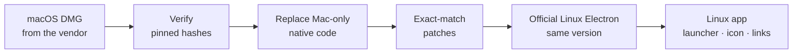

<p align="center">
  
</p>

<h1 align="center">electron-transplant</h1>

<p align="center">
  <b>Run macOS-only Electron apps on Linux.</b><br>
  Linear · Notion · Figma · Superhuman, from the vendor's own macOS build.
</p>

<p align="center">
  <a href="https://github.com/wbunting/electron-transplant/actions/workflows/test.yml"></a>
  <a href="LICENSE"></a>
  
  
</p>

---

Plenty of desktop apps are Electron underneath: JavaScript on top of Chromium.
Electron's API is the same on every platform, so an app's code can move from its
macOS build onto the **official Linux build of the same Electron version**. What
doesn't move is the small Mac-native part. electron-transplant handles that part
for each app, verifies everything on the way, and installs a normal Linux app with a
launcher, an icon and working links.

Nothing from the vendor is in this repository or redistributed: you download the
app's macOS DMG yourself, and the build runs on your machine.

## Apps

| App | Version | Mac-only parts and how they're handled | Notes |
| --- | --- | --- | --- |
| **Linear** | 1.32.8 | 3 trackpad addons → small JS stand-ins | |
| **Notion** | 7.43.0 | SQLite addon → its official Linux build; 3 others trimmed | |
| **Figma** | 126.11.9 | Figma's own Linux code path; local fonts via fontconfig | [notes](docs/apps.md#figma) |
| **Superhuman** | 1045.0.0 | none | [sign-in](docs/apps.md#superhuman) |

Want another app? If it's Electron, `electron-transplant inspect` shows how much work
it is in about a minute. [Request it](https://github.com/wbunting/electron-transplant/issues/new?template=app-request.md)
or [add it](CONTRIBUTING.md#adding-an-app).

## Quick start

```sh
git clone https://github.com/wbunting/electron-transplant
cd electron-transplant
npm ci --ignore-scripts

bin/electron-transplant fetch linear      # the pinned macOS DMG, from Linear, verified
bin/electron-transplant build linear --install
linear-desktop
```

That downloads Linear's own macOS DMG, builds into `build/`, installs under
`~/.local` and puts **Linear** in your app launcher. It never touches the app's
profile (`~/.config/Linear`). If the vendor has shipped a newer version than the
pinned one, the build stops and says so: see [Getting the apps](#getting-the-apps).

## Why it's safe to run

- **Verified end to end.** The DMG must match a pinned SHA-256, `app.asar` must match
  the hash the app's own bundle declares, and the Linux Electron build must match
  its pinned hash. Nothing from the DMG is executed during the build.
- **No leftover native code.** After assembly every file is scanned: a single Mac,
  Windows or wrong-architecture binary fails the build.
- **Chromium's sandbox stays on.** Launchers pass no sandbox-disabling switches.
- **Fails loudly.** Patches must match the vendor's code exactly, so a vendor update
  breaks the *build*, never silently the app.
- **Rootless and reversible.** Versioned installs under `~/.local` behind a `current`
  symlink; the previous version stays for rollback.

More in [SECURITY.md](SECURITY.md).

## How it works



A small compatibility layer runs inside the app:

- **macOS window buttons** for apps that draw their own title bar and expect the
  red, yellow and green "traffic lights" (Linear, Notion), in a sandboxed overlay that
  follows focus, theme and fullscreen.
- **A recorder** that notes every Mac-only Electron API the app touches at runtime.
  `electron-transplant report <app>` turns it into a to-do list, which is how a new
  app goes from "it starts" to "it works". It never logs URLs, arguments or your
  home path.

`inspect` surveys a DMG before you write any config (abridged):

```console
$ electron-transplant inspect linear
Linear-1.32.8-universal.dmg  sha256 08d42b91…  pinned (universal)
Linear 1.32.8  bundle com.linear  Electron 44.9.1

Native code in the app:
  [shim] @linear/desktop-force-press
      mach-o node_modules/@linear/desktop-force-press/build/Release/force_press.node
  [shim] @linear/desktop-haptics
      mach-o node_modules/@linear/desktop-haptics/build/Release/haptics.node
  [shim] @linear/desktop-swipe-navigation
      mach-o node_modules/@linear/desktop-swipe-navigation/build/Release/swipe_navigation.node

macOS window chrome (occurrences):
  titleBarStyle              4
  trafficLightPosition       1
  setWindowButtonPosition    1

Configured patches against this bundle:
  ok   disable-auto-update-on-linux (1/1)
  ok   mac-title-bar-on-linux (1/1)
```

The full pipeline and compatibility layer are described in
[docs/how-it-works.md](docs/how-it-works.md).

## Install

### Requirements

- Linux on x86_64, Wayland or X11.
- Node.js 22.15 or newer, npm, Python 3, `unzip`.
- 7-Zip to read the DMG (`7zz` or `7z`: the `7zip` package on most distributions).
  On Arch without it, the build fetches Arch's package rootlessly and checks its
  signature with `pacman-key`. `SEVENZIP=/path/to/7z` picks a specific binary.
- For desktop entries: `xdg-utils` and `desktop-file-utils` (usually present).

Tested on Arch Linux with Hyprland (Wayland, 2× HiDPI). Other desktops and
distributions should work but are untested: reports are welcome.

### Getting the apps

`electron-transplant fetch <app>` downloads the pinned **macOS** DMG (the Intel or
universal build) from the vendor's own server, checks its SHA-256 and keeps it in
`~/.cache/electron-transplant/downloads/`, where `build` finds it.
`electron-transplant sources` lists every URL and hash.

Or download it yourself:

| App | Download | Put it in |
| --- | --- | --- |
| Linear | https://linear.app/download | `~/Downloads/` |
| Notion | https://www.notion.com/desktop | `~/Downloads/` |
| Figma | https://www.figma.com/downloads/ (Intel) | `~/Downloads/figma-desktop-mac/` |
| Superhuman | https://superhuman.com/download | `~/Downloads/superhuman-mac/` |

Or pass `--dmg PATH`. Figma only serves its current and previous release, so an
older pinned Figma version may no longer be downloadable. A vendor release newer
than the pinned one needs pinning first: see
[CONTRIBUTING.md](CONTRIBUTING.md#updating-an-app-to-a-new-version).

### Commands

```sh
ln -s "$PWD/bin/electron-transplant" ~/.local/bin/   # optional

electron-transplant apps                    # configured apps and pinned versions
electron-transplant fetch notion            # download and verify the pinned DMG
electron-transplant inspect notion          # survey a DMG
electron-transplant build notion            # build into build/ only
electron-transplant build notion --install  # build and install under ~/.local
electron-transplant report notion           # Mac-only APIs the app hit at runtime
```

Installed apps are named `<app>-desktop` (`linear` and `notion` are already taken by
those apps' command-line tools). Each gets a launcher in `~/.local/bin`, a desktop
entry with the app's URL schemes, and its icon.

### Settings

Each app has an environment prefix: `LINEAR_`, `NOTION_`, `FIGMA_DESKTOP_`,
`SUPERHUMAN_DESKTOP_`.

| Variable | Effect |
| --- | --- |
| `<PREFIX>_USE_WAYLAND=0` | XWayland instead of native Wayland |
| `<PREFIX>_TRAFFIC_LIGHTS=0` | no emulated window buttons |
| `<PREFIX>_FRAMELESS=1` | frameless window, as on macOS. Off by default because Hyprland floats frameless windows; worth trying on desktops that draw their own title bar |

App-specific settings and notes: [docs/apps.md](docs/apps.md).

### Packaging

For distribution packages (pacman, Nix): `sources.json` lists every input with its
URL and hash, `build --offline` builds from explicit inputs without network or
`$HOME`, and `install --layout package` stages a `/usr`-style layout into a DESTDIR.
See [docs/packaging.md](docs/packaging.md).

## FAQ

**Do the apps update themselves?**
No: their updaters would try to install macOS releases, so they're switched off.
Download the newer DMG and rebuild; if it isn't pinned yet, see
[CONTRIBUTING.md](CONTRIBUTING.md#updating-an-app-to-a-new-version).

**Why the macOS build?**
The macOS bundle declares a hash for its own `app.asar`, which the build checks, and
its Mac-only native code is mostly optional extras (trackpad, haptics) that the apps
already skip on other platforms.

**Will it work for app X?**
If X is an Electron app with a macOS build, probably, with some work.
`electron-transplant inspect` tells you how much. Native Mac apps (Swift, AppKit,
Catalyst) can't be transplanted.

**ARM64?**
Not yet: the build checks binaries for x86_64. Linux Electron ships arm64, so it's
possible.

**Is this allowed?**
electron-transplant doesn't distribute any app. You download each app from its
vendor, and your use of it stays subject to the vendor's terms.

## Contributing

Updating an app to a new vendor version is the most useful contribution, and
usually a small one. See [CONTRIBUTING.md](CONTRIBUTING.md).

## License

[MIT](LICENSE), for this repository's code only, not the apps it adapts.

Not affiliated with or endorsed by Linear, Notion, Figma or Superhuman. Their names
are trademarks of their owners.
